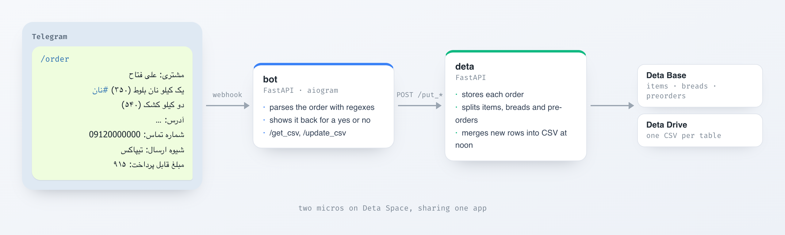

# OrderMan

**A Telegram bot that turns order messages into spreadsheets.**

 

 

Paste an order into the chat in a fixed template, and OrderMan reads out the customer, the items with their prices, the address, the delivery method and the total, then shows it back for a yes or no. Confirmed orders are stored, split into items, breads (tagged `#نان`) and pre-orders (tagged `#پیش`), and merged into one CSV per table every day at noon.

## Commands

| Command | What it does |
| :-- | :-- |
| `/order` | send an order and confirm it |
| `/get_csv` | download the CSV files |
| `/update_csv` | merge new orders into the CSVs now |

## How it's built

Two FastAPI services deployed together on [Deta Space](https://deta.space), described in the `Spacefile`:

- **`bot/`** receives Telegram updates on a webhook and runs the conversation with aiogram.
- **`deta/`** stores orders in Deta Base, keeps the CSVs on Deta Drive, and runs the daily merge as a scheduled action.

The bot needs a `TELEGRAM_BOT_TOKEN`. To run it somewhere other than Deta Space, replace the storage calls in `deta/core/`.
